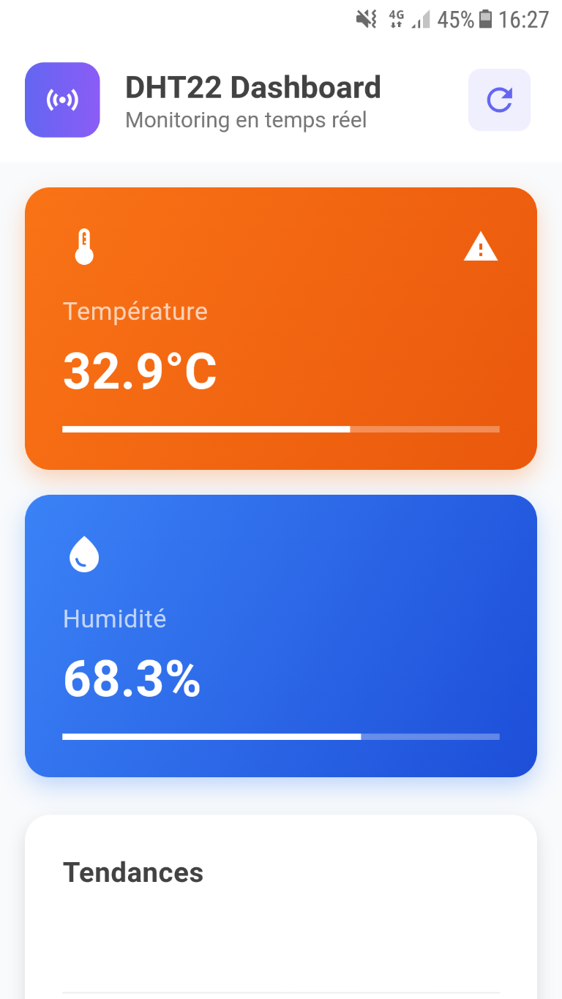
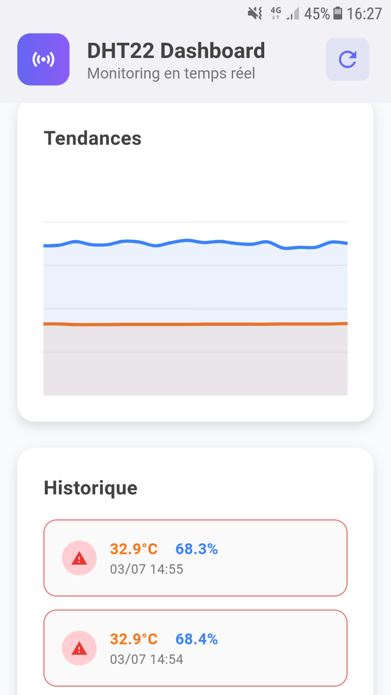
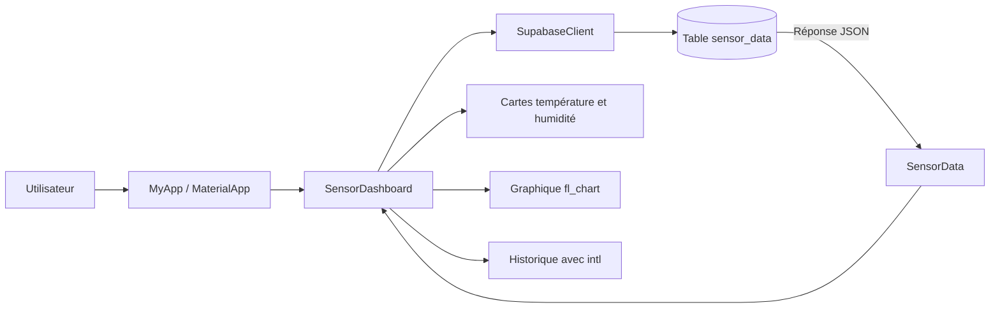

# DHT22 Dashboard

Application mobile Flutter de supervision d’un capteur DHT22. Elle affiche les dernières mesures de température et d’humidité, leurs tendances et un historique alimenté par Supabase.

## Captures d’écran

### Tableau de bord

Les cartes affichent les dernières valeurs mesurées ainsi que les alertes éventuelles.



### Tendances et historique

La courbe compare les mesures récentes et l’historique présente les relevés horodatés.



## Fonctionnalités

- Affichage de la dernière température et de la dernière humidité.
- Indication des alertes de température, d’humidité et d’état du relevé.
- Actualisation automatique toutes les 30 secondes et bouton d’actualisation manuelle.
- Courbe de tendance comparant température et humidité sur jusqu’à 20 relevés de la fenêtre chargée.
- Historique des 10 derniers relevés avec date et heure.
- Mise en page adaptative pour les écrans mobiles et plus larges.
- États de chargement, erreur de connexion et possibilité de réessayer.

## Architecture

Le code applicatif est regroupé dans `lib/main.dart`. `MyApp` initialise l’interface Flutter, `SensorDashboard` gère l’état, le chargement périodique et l’affichage, et `SensorData` convertit les réponses JSON en objets Dart. Le tableau de bord interroge la table Supabase `sensor_data` et utilise `fl_chart` et `intl` pour présenter les données.



Les mesures sont triées par date décroissante et limitées aux 50 dernières. Le graphique trace jusqu’à 20 relevés de cette liste chargée, tandis que l’historique en affiche jusqu’à 10.

## Technologies

- **Flutter / Dart** pour l’application mobile.
- **Supabase Flutter** pour lire les mesures.
- **fl_chart** pour la courbe de température et d’humidité.
- **intl** pour formater les dates.

## Lancer l’application

Prérequis : Flutter configuré et un appareil ou émulateur disponible.

```bash
flutter pub get
flutter run
```

### Configuration Supabase

Renseignez l’URL du projet et une clé anon dans les constantes utilisées par `Supabase.initialize` au début de `lib/main.dart`. Configurez les règles RLS pour autoriser uniquement les accès nécessaires à `sensor_data`. N’intégrez jamais une clé `service_role` dans l’application.
